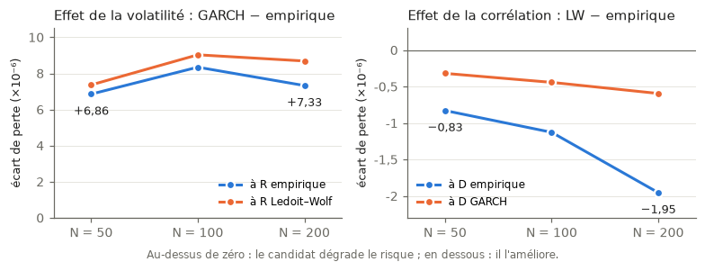

# Covariance Decomposition for Minimum-Variance Portfolios

**Does the gain of a better covariance forecast come from the volatilities or from the correlations?**

Minimum-variance (GMV) portfolios depend on a single input, the covariance matrix
Σ, and on its inverse. The literature improved Σ along two separate axes: **time**
(GARCH, DCC) and **dimension** (Ledoit–Wolf shrinkage). Studies usually compare
"all-in-one" estimators, so they cannot say *which part* of the model produces the
gain.

This project uses the unique decomposition

$$\Sigma_t = D_t\, R_t\, D_t, \qquad D_t = \mathrm{diag}(\sigma_{1,t},\dots,\sigma_{N,t}),\quad R_t = \text{correlation matrix},$$

and crosses volatility models with correlation models in a **2 × 3 factorial grid**,
so that each change in realized risk can be attributed to one building block.

| D \ R            | Sample | Ledoit–Wolf | DCC |
|------------------|:------:|:-----------:|:---:|
| **Sample**       | (1)    | (2)         | (3) |
| **GARCH(1,1)**   | (4)    | (5)         | (6) |

## Key results

On 281 S&P 500 stocks, out-of-sample from 2005 to 2025 (249 monthly rebalances,
5,229 daily returns), at N = 50, 100 and 200 assets:

- **Correlation shrinkage is the most robust gain.** Ledoit–Wolf reduces realized
  variance in all 6 contrasts (p < 0.01 %), and the gain **more than doubles with
  dimension** (−0.83 → −1.95 × 10⁻⁶ from N = 50 to N = 200), with a shrinkage
  intensity of only ≈ 2 %. It corrects the small eigenvalues that the inversion amplifies.
- **GARCH volatility degrades the GMV portfolio.** The loss differential is positive
  in 9/9 contrasts (significant in 6) and stays significant in **12/12 "hybrid"
  contrasts** where the correlation matrix is estimated on the same residuals on both
  sides, so only the diagonal changes. A better volatility model is a worse input for
  an optimizer that inverts the matrix.
- **DCC brings no gain** in the unconstrained portfolio, as estimated here (composite
  likelihood in high dimension).
- **Volatility produces the largest differences, but only correlation produces them in
  the right direction.** The GARCH effect is stable across dimensions; the shrinkage
  effect grows with N/T (0.04 → 0.16), as Marčenko–Pastur predicts.
- **Robustness:** under a long-only constraint the ranking changes (GARCH × DCC
  becomes the least risky cell), consistent with the implicit regularization of
  Jagannathan & Ma (2003). With 1 % transaction costs, GARCH turns the portfolio over
  six times more and its performance fee falls from +131 to −3,111 bp, while
  Ledoit–Wolf rises from +20 to +63 bp.



Best cell: **(2) sample volatility × Ledoit–Wolf correlation**, with an annualized
realized volatility of 13.85 / 13.59 / 12.70 % at N = 50 / 100 / 200.

## Methodology

- **Data:** daily adjusted prices from Yahoo Finance, March 2000 to December 2025.
  The universe is the current S&P 500 composition applied to the whole history
  (survivorship bias acknowledged). At each date, the N stocks with the largest
  average dollar volume over the estimation window are selected.
- **Backtest:** rolling window of T = 1,250 days, strictly prior to each rebalance (no
  look-ahead), monthly rebalancing (21 days), buy-and-hold drift between rebalances,
  unconstrained GMV weights w = Σ⁻¹1 / 1ᵀΣ⁻¹1.
- **Volatility block D:** rolling sample standard deviation; univariate GARCH(1,1)
  (QML) with a fallback to the sample estimate when a fit fails.
- **Correlation block R:** sample correlation; Ledoit–Wolf (2004) linear shrinkage
  towards the identity, renormalized to a unit diagonal so that it never touches D;
  scalar DCC (Engle, 2002), composite likelihood for N ≥ 30.
- **Evaluation:** Engle & Colacito (2006) criterion, the best covariance estimator is
  the one whose GMV portfolio has the lowest realized variance. Daily loss
  ℓₜ = (πₜ − π̄)², loss differentials tested with Diebold–Mariano and Newey–West HAC
  standard errors (22 lags), plus the weighted Engle–Colacito version as a check.
- **Contrasts:** effect of D at fixed R, effect of R at fixed D, D × R interaction, and
  hybrid cells with a common residual basis.
- **Robustness:** long-only GMV (SLSQP), GARCH forecasts at a 21-day horizon,
  five market sub-periods, transaction costs and the Fleming–Kirby–Ostdiek
  performance fee.

## Usage

```bash
python -m venv .venv
.venv/Scripts/activate          # Windows; use `source .venv/bin/activate` elsewhere
pip install -r requirements.txt

python -m src.data --config config.yaml          # download and clean the panel
python -m src.experiments --config config.yaml   # 6-cell grid at N = 50, 100, 200
python -m src.robustness --config config.yaml --horizon 1
python -m src.robustness --config config.yaml --horizon 21
python -m src.robustness --config config.yaml --multi-n   # robustness tables

pytest                                           # 52 tests
```

All parameters live in `config.yaml` (no magic numbers in the code). Results are
written to `outputs/` (tables and figures), which is not versioned. Code comments
are in French.

## Project structure

```
src/
  data.py                 download, cleaning, return panel
  variance_models.py      D block: sample volatility, GARCH(1,1)
  correlation_models.py   R block: sample, Ledoit–Wolf, DCC
  grid.py                 Σ = D·R·D assembly for the six cells
  backtest.py             rolling GMV backtest, turnover, metrics
  evaluation.py           losses, Diebold–Mariano tests, attribution, performance fee
  experiments.py          multi-dimension runs, sub-periods, table export
  robustness.py           long-only, 21-day GARCH horizon, diagnostics
  plots.py                figures
tests/                    unit tests for every module
config.yaml               single source of parameters
```

## Limitations

- Survivorship bias: firms that left the index before 2025 are absent, so the level
  of risk is likely understated (all cells share the same universe).
- The DCC conclusion is tied to the composite likelihood; compared with the full
  likelihood on a single window, persistence is much higher (0.95–0.97 vs 0.72).
- The criterion is locally blind (Engle–Colacito *costless mistake*): a wrong matrix
  can yield the right weights for some expected returns, and the GMV evaluates a
  single point.

Natural extensions: nonlinear shrinkage, a realized-volatility (HAR) volatility block,
and a non-US universe.

## References

- Markowitz (1952), *Portfolio Selection*, Journal of Finance.
- Marčenko & Pastur (1967), *Distribution of Eigenvalues for Some Sets of Random Matrices*.
- Michaud (1989), *The Markowitz Optimization Enigma: Is "Optimized" Optimal?*
- Chopra & Ziemba (1993), *The Effect of Errors in Means, Variances, and Covariances on Optimal Portfolio Choice*.
- Diebold & Mariano (1995), *Comparing Predictive Accuracy*.
- Engle (2002), *Dynamic Conditional Correlation*.
- Jagannathan & Ma (2003), *Risk Reduction in Large Portfolios: Why Imposing the Wrong Constraints Helps*.
- Ledoit & Wolf (2004), *A Well-Conditioned Estimator for Large-Dimensional Covariance Matrices*.
- Engle & Colacito (2006), *Testing and Valuing Dynamic Correlations for Asset Allocation*.
- Bollerslev, Patton & Quaedvlieg (2018), *Modeling and Forecasting (Un)Reliable Realized Covariances for More Reliable Financial Decisions*.
- Engle, Ledoit & Wolf (2019), *Large Dynamic Covariance Matrices*.
- Pakel, Shephard, Sheppard & Engle (2021), *Fitting Vast Dimensional Time-Varying Covariance Models*.
